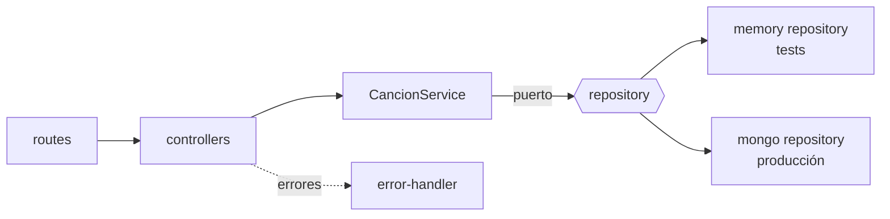

# Canciones API

API REST de catálogo de canciones con **Express 5 + MongoDB (Mongoose)**, arquitectura por capas, validación con zod y pruebas sin base de datos externa.

[](https://github.com/zulnidi/express01/actions/workflows/ci.yml)

**English summary:** Layered Express 5 REST API for a songs catalogue. Routes → controllers → service → repository (ports), with a single composition root. Zod validation, centralized error mapping, helmet/CORS/rate limiting, OpenAPI contract at `/openapi.json`, 38 Vitest + Supertest tests running against an in-memory repository. The Mongoose adapter is not covered by automated tests here (no MongoDB available in the dev environment).

## Qué hace

CRUD de canciones con paginación, filtro por género, búsqueda por texto y ordenamiento. Evita duplicados (título + artista, sin distinguir mayúsculas).

## Arquitectura



`src/server.js` es el único *composition root*: crea el repositorio Mongo y se lo inyecta al servicio. Las pruebas inyectan el repositorio en memoria vía `createApp({ repository })`.

## Decisiones de diseño

- **Inversión de dependencias:** [`CancionService`](src/services/cancion.service.js) depende de un repositorio con métodos `list/findById/create/update/delete`, no de Mongoose.
- **Responsabilidad única:** esquemas en [`domain/cancion.schemas.js`](src/domain/cancion.schemas.js), reglas de negocio en el servicio, HTTP en controladores, mapeo de errores en [`middlewares/error-handler.js`](src/middlewares/error-handler.js).
- **Errores de dominio** (`NotFoundError` 404, `ConflictError` 409) traducidos a HTTP en un solo lugar; los 500 no filtran detalles.
- **Seguridad:** helmet, CORS acotado por `CORS_ORIGINS`, límite de peticiones, JSON máx. 100 kb, regex escapadas en búsquedas.

## Cambios respecto a la versión original

- La lista ahora responde `{ data, page, limit, total, pages }` en lugar de un arreglo.
- Reglas de validación relajadas (título ≥ 1 y artista ≥ 2 caracteres) para aceptar títulos cortos reales.
- Se corrigieron imports sensibles a mayúsculas que fallaban en Linux.

## Cómo ejecutarlo

```bash
cp .env.example .env   # define MONGO_URI
npm install
npm run dev            # http://localhost:3000
```

## API

| Método | Ruta | Descripción |
|---|---|---|
| GET | `/canciones?page&limit&genero&q&orden` | Lista paginada (`orden`: recientes, titulo, anio) |
| POST | `/canciones` | Crea (201 + `Location`) |
| GET | `/canciones/:id` | Obtiene |
| PUT | `/canciones/:id` | Reemplaza (todos los campos) |
| PATCH | `/canciones/:id` | Actualiza parcialmente |
| DELETE | `/canciones/:id` | Elimina (204) |
| GET | `/health`, `/openapi.json` | Salud y contrato |

## Pruebas

```bash
npm test          # 38 pruebas
npm run coverage  # ~98 % líneas sobre la lógica propia
npm run lint && npm run format:check
```

Cubren esquemas, servicio y API completa (paginación, filtros, 400/404/409, JSON inválido, rate limit, 500). La cobertura **excluye** `src/server.js` y el adaptador Mongoose (`cancion.mongo.repository.js`): no se pudo probar contra un MongoDB real en el entorno de desarrollo.

## Próximos pasos

- Pruebas de integración del adaptador Mongo (p. ej. con `mongodb-memory-server` en CI).
- Autenticación para escritura.

## Autora

**Zullie Nicole Díaz López** · [GitHub](https://github.com/zulnidi)
